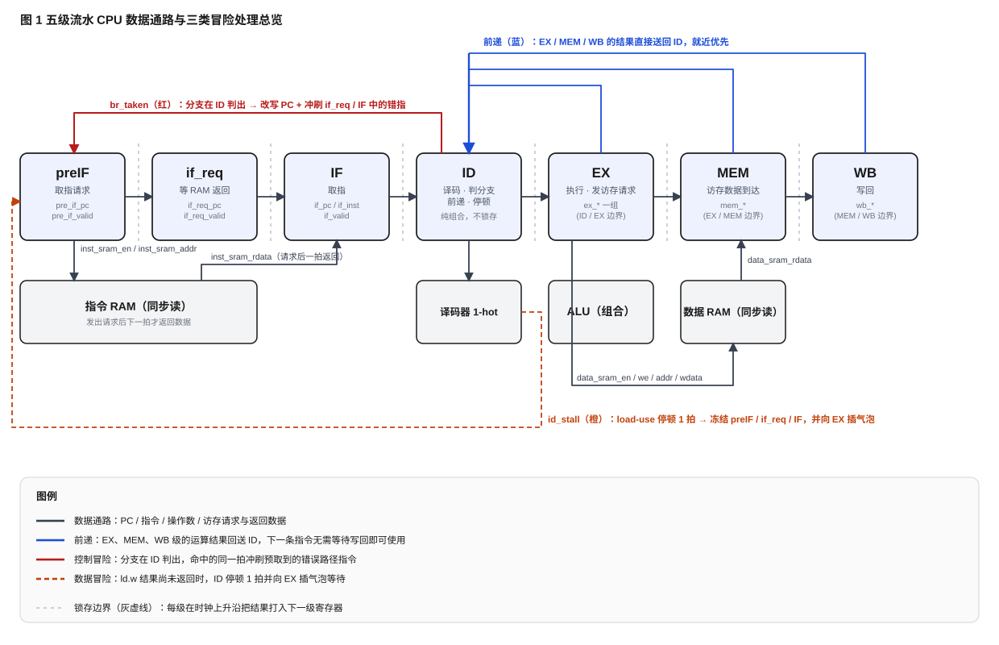
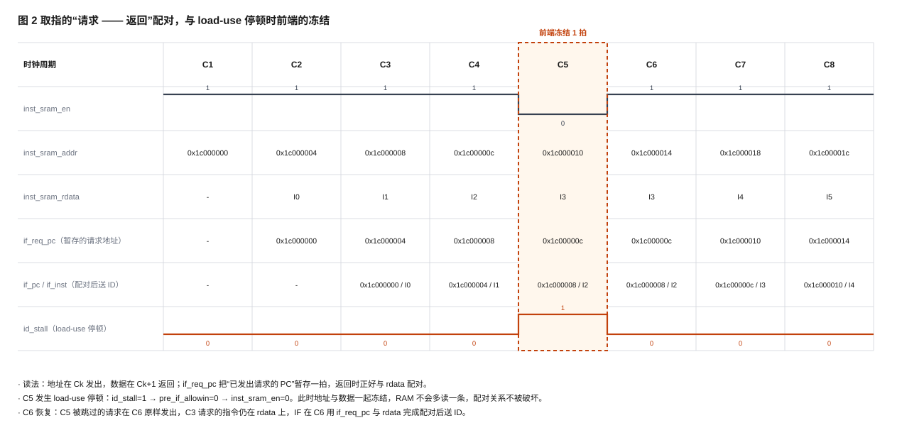
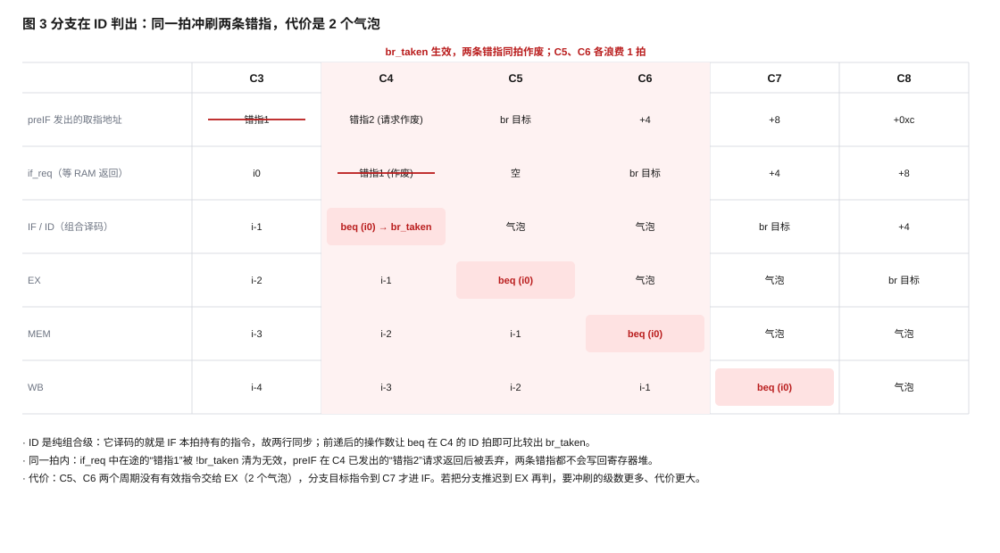

# 流水线 CPU 设计专题实验报告

**作者**：林岳　**学号**：2024K8009929018
**专题范围**：实践任务 7、8、9（五级流水 CPU 的建立、冒险处理与前递优化）

## 一、任务与判据

本专题的起点是实践 6 完成的单周期 CPU，目标是在此基础上做出一个能正确跑通全部 20 个功能点的五级流水 CPU，并按任务 7 → 8 → 9 的顺序解决流水化带来的各类冒险。

支持的指令为 20 个功能点 n1~n20：`lu12i.w`、`add.w`、`addi.w`、`sub.w`、`slt`、`sltu`、`and`、`or`、`xor`、`nor`、`slli.w`、`srli.w`、`srai.w`、`ld.w`、`st.w`、`beq`、`bne`、`bl`、`jirl`、`b`。

验收判据是**逐指令比对**：CPU 每一条写回都要通过 `debug_wb_pc / debug_wb_rf_we / debug_wb_rf_wnum / debug_wb_rf_wdata` 上报，测试台 `mycpu_tb.v` 把它与参考执行流 `gettrace/golden_trace.txt` 逐条对照，一旦不一致立刻报错停下；n1~n20 全过时打印 `----PASS!!!`。上板验收对应的现象是数码管停在 `0x14000014`、双绿灯亮。

三个任务的测试镜像是同一套汇编、不同配置编出来的：任务 7 的镜像在 ALU 指令之间插了 4 条 nop（`NOP_INSERT=1`），任务 8、9 的镜像不插 nop（`NOP_INSERT=0`）。

按课程口径，三个任务交付的是**三个逐级增量**的版本，每版只在上版基础上叠加一处机制，提交时附“相对上一实验”的逐文件 patch：

| 任务 | 这一版新增的机制 | 镜像 | 提交物 |
|---|---|---|---|
| 7 | 五级流水骨架本身；**不处理任何冒险**（靠镜像里的 nop 拉开相关指令的距离） | `NOP_INSERT=1` | `prj2/exp7/myCPU` + `patch/exp6_to_exp7.patch` |
| 8 | `cancel` 解控制冒险 + **阻塞**解数据冒险（相关指令等到新值能从寄存器堆读到才放行） | `NOP_INSERT=0` | `prj2/exp8/myCPU` + `patch/exp7_to_exp8.patch` |
| 9 | 把阻塞换成 **EX / MEM / WB 三路前递**，只剩 load-use 需要停一拍 | `NOP_INSERT=0` | `prj2/exp9/myCPU` + `patch/exp8_to_exp9.patch` |

三个版本不是“把同一段代码写三遍”，而是**同一棵代码树上的三次叠加**：任务 7 的 RTL 是任务 8 的基线，任务 8 的 RTL 又是任务 9 的基线，patch 逐级应用可以从单周期的 exp6 一路走到 exp9。

## 二、设计思路

### 2.1 总体结构

整体结构如图 1 所示。流水线切成 5 个“干活级”——IF 取指、ID 译码、EX 执行、MEM 访存、WB 写回；由于**指令 RAM 是同步读**（本拍给地址、下一拍才回数据），取指一侧再多插了 preIF（发出请求）与 if_req（等数据返回）两个小级。这两级只是取指机制的“泵”，不改变指令语义，真正承担译码/执行/访存/写回职责的仍是标准的五级。



每一级之间用 `valid` / `ready_go` / `allowin` 三个信号握手：

```
allowin(本级) = !valid(本级) || ( ready_go(本级) && allowin(下一级) )
```

因为 `allowin` 逐级向后依赖，这条式子天然形成一条从 WB 一路回传到 preIF 的**背压链**：后面任何一级停住，取指端自动跟着停，不需要额外的全局停顿信号。这条链是本设计里所有冒险处理的公共基础设施。

### 2.2 取指前端：同步 RAM 下 PC 与指令的配对

这是本专题最核心的一处设计。同步 RAM 与“理想存储器”最大的区别是：**它没有撤销键**——只要 `en=1`，下一拍必然返回一条数据，你无法事后告诉它“这一条我不要了”。

由此引出两个必须处理的问题。

**问题一：PC 与指令如何对齐。** 请求发出与数据返回之间隔了一拍，如果只记 PC 不记请求，返回时根本不知道这条指令属于哪个 PC。做法是加一级 `if_req`：把“已经发出请求的 PC”存进 `if_req_pc`，在数据返回的那一拍与 `inst_sram_rdata` **成对**锁进 `if_pc` / `if_inst`。

**问题二：停顿期间不能乱发请求。** 如果停顿的时候前端还在发请求，RAM 会照常返回数据，回来时就和 `if_req_pc` 里记的 PC 错位，从错位那一拍起整条流水线全乱。做法是把请求使能与前端能否前进**绑死**：

```verilog
assign inst_sram_en = pre_if_valid && pre_if_allowin;
```

停顿发生时 `pre_if_allowin=0`，于是 `en=0`：地址不再前进、RAM 也不再采样，**PC 与数据一起冻结**，配对关系永远不会被破坏。

图 2 是取指前端的时序：地址在 Ck 发出、数据在 Ck+1 返回；C5 发生 load-use 停顿时 `inst_sram_en` 拉低，被跳过的请求在 C6 原样发出，PC 与指令的配对始终成立。



还有一处细节值得一提：`pre_if_pc` 的复位值取的是 `0x1bfffffc`（程序入口 `0x1c000000` 减 4），而不是入口本身。因为 PC 只在时钟上升沿 +4，这样复位后第一次真正送上地址总线的值正好是入口地址；而那一拍 `pre_if_valid=0`、`en=0`，`0x1bfffffc` 这个地址永远不会被真的取到。看起来“更合理”的写法（直接填入口地址）反而会跳过第一条指令。

### 2.3 译码：独热译码与立即数拼接

LoongArch 指令按固定位段切分，译码的做法是先切字段、再把各字段送进独热译码器（`tools.v` 中的 `decoder_2_4` / `decoder_4_16` / `decoder_5_32` / `decoder_6_64`），最后把对应位段的独热线相与，得到该指令的命中线：

```verilog
assign inst_add_w = op_31_26_d[6'h00] & op_25_22_d[4'h0] & op_21_20_d[2'h1] & op_19_15_d[5'h00];
assign inst_sub_w = op_31_26_d[6'h00] & op_25_22_d[4'h0] & op_21_20_d[2'h1] & op_19_15_d[5'h02];
```

选择独热译码而不是 `case` 语句，是因为每条指令的判定**互相独立**：新增一条指令只是多加一行，不会影响别的行，综合器也容易把它并行成比较树，既好读又不容易写出优先级覆盖或漏 `default` 的错误。

立即数按 `need_ui5` / `need_si12` / `need_si16` / `need_si20` / `need_si26` / `src2_is_4` 这几个标记选择拼接方式：`jirl`/`bl` 取常数 4（用于算返回地址 PC+4），`lu12i.w` 取 si20 左移 12 位，移位指令取 ui5 零扩展，其余按 si12 符号扩展。ALU 的功能选择码 `alu_op` 同样是 12 位独热码，由各指令命中线按运算类别或起来。

### 2.4 三类冒险的处理

> 本节描述的是**任务 9 交付版**（前递 + load-use 停顿 + cancel）的处理方式。任务 8 交付时尚无前递：数据冒险一律用**阻塞**解决——ID 需要的操作数只要与 EX / MEM / WB 中任何一条尚未写回的指令撞上，就冻结前端若干拍，直到寄存器堆里读到的已经是新值；任务 9 把这套阻塞换成了三路前递，只有 `ld.w` 的 load-use 这一种“前递也救不了”的情况仍然停顿。因此 §2.4.2 是任务 9 新增的内容，§2.4.3 是从任务 8 保留下来的那一处。

#### 2.4.1 控制冒险：分支在 ID 判出，命中当拍冲刷

分支如果等到 EX 再判，此前取回的错指已经深入流水两级以上，要冲掉更多级。本设计把分支判定**提前到 ID**：`beq`/`bne` 用**前递之后**的两个操作数直接比较，`b`/`bl`/`jirl` 直接算目标地址，全部在 ID 这一拍组合得到 `br_taken` 与 `br_target`。

命中时，同一拍做两件事：

1. 把 `pre_if_pc` 改写为 `br_target`（相当于改 PC）；
2. 用 `!br_taken` 把取指前端里两条错指同时作废——`if_req` 中在途的那条被清成无效，IF 中的那条也被清掉。

代价是 2 个气泡（图 3）：C5、C6 两个周期没有有效指令交给 EX，分支目标指令到 C7 才进 IF。如果推迟到 EX 再判，需要冲刷的级数更多、代价更大——这也是选择“ID 判分支”的原因。



#### 2.4.2 数据冒险之一：EX / MEM / WB 三路前递

流水线里“上一条刚算完、下一条马上要用”的情况，等写回寄存器堆就太晚了。做法是把 EX、MEM、WB 三级的结果直接回送到 ID 的操作数选择上，按**就近优先**排优先级：

```
操作数实际值 = EX 级 ALU 结果 > MEM 级结果 > WB 级写回值 > 寄存器堆读出值
```

三路前递都加了三个过滤条件：`dest != 0`（x0 恒为 0，等它没有意义）、`gr_we`（不写寄存器的指令不产生新值），以及 EX 那一路额外要求 `~res_from_mem`——因为 EX 拍 `ld.w` 只有地址、数据还没回来，此刻把它前递过去是“毒药”，会送出一个错误的地址值。

#### 2.4.3 数据冒险之二：load-use 停顿

`ld.w` 的数据要到 MEM 级才从 RAM 出来，EX 拍无论怎么前递都拿不到。因此当“EX 正在做 load”且“ID 现在的指令正好要用它写的那个寄存器”时，置 `id_stall`：

```verilog
wire id_stall = if_valid && ex_valid && ex_res_from_mem && ex_gr_we && (ex_dest != 5'b0)
             && ( (id_uses_rj  && (ex_dest == rj))
               || (id_uses_rkd && (ex_dest == (src_reg_is_rd ? rd : rk))) );
```

停顿一拍的效果是：**只冻结前端**（preIF / if_req / IF 停住），EX 里那条 `ld.w` 照常流到 MEM，向 EX 插一个气泡；下一拍数据已经到了 MEM，再由 MEM→ID 这一路前递供数，ID 接着往下走。所以 load-use 的代价恰好是 1 拍，而不是把整条流水线停死。

判据里还带了两个“少停一次”的过滤：`ex_gr_we` 排除不写寄存器的指令，`id_uses_rj / id_uses_rkd` 排除本指令根本用不到的源操作数。例如 `lu12i.w` 只写不读，就不该因为后面紧跟一条写 rj 的指令而白停一拍。

## 三、重点、难点与设计取舍

**最难的一处是同步 RAM 的“不可撤销”。** 理想存储器模型下，取指与停顿是两件互不干扰的事；换成同步读之后，“停顿期间还在发请求”会立刻导致 PC 与指令错位。最后的解法（把 `inst_sram_en` 与 `allowin` 绑死）本身只有一行代码，但要先想明白“同步 RAM 没有撤销键”这一点，才写得出这一行。

**取舍之一：分支在 ID 判还是 EX 判。** ID 判的收益是只冲 2 级、只花 2 拍；代价是 ID 的组合路径变长——译码、前递多路选择、操作数比较、目标地址计算都要在一个周期内完成。本设计选择了 ID 判，理由是实测时序仍有充足余量（见第四节），而流水线被冲刷的代价是实打实的性能损失。

**取舍之二：前递的优先级次序。** 三路前递按 EX > MEM > WB 排，是因为越靠前的级算出的结果越新。次序写反了在简单测试里未必暴露，但在“连续三条指令依次依赖同一个寄存器”的序列里会立刻出错，所以这一处不能含糊。

**取舍之三：停顿判据要不要加过滤。** 最保守的写法是“目标寄存器撞上任何一个源寄存器就停”，正确但会白停。加上 `ex_dest != 0`、`ex_gr_we`、`id_uses_rj / id_uses_rkd` 之后，正确性不变而停顿次数减少。这一类“正确但可以更聪明”的地方，是流水线设计里值得反复打磨的部分。

**关于 ID 不锁存。** 本设计里 ID 是纯组合级，它的“内容”就是 IF 本拍持有的指令，译码结果由 ID/EX 边界寄存器在时钟沿抓走。因此波形上 ID 与 IF 永远看到同一条指令，这是结构决定的，不是仿真假象。

## 四、验证与结果

### 4.1 功能仿真

三个任务在 iverilog + `soc_bram` 测试台上各跑一轮，均为 n1~n20 全过：

| 任务 | 这一版用的镜像 | 结果 | 日志 |
|---|---|---|---|
| 任务 7（流水线建立） | `NOP_INSERT=1` | n1~n20 全 PASS，`----PASS!!!`（最后一点 2058995 ns） | `prj2/logs/exp7_run.log` |
| 任务 8（cancel + 阻塞） | `NOP_INSERT=0` | n1~n20 全 PASS，`----PASS!!!`（最后一点 1349305 ns） | `prj2/logs/exp8_run.log` |
| 任务 9（前递优化） | `NOP_INSERT=0` | n1~n20 全 PASS，`----PASS!!!`（最后一点 639855 ns） | `prj2/logs/exp9_run.log` |

同一套测试程序下，三版的结束时间本身就说明三阶段的递进：任务 8 比任务 7 快约 1.5 倍（镜像里不再靠 4 条 nop 拉开距离），任务 9 又比任务 8 快约一倍（阻塞换成了前递）。任务 7 在提交前还在干净解压的课程包上独立复跑过一轮，同样 n1~n20 全 PASS，日志 `prj2/logs/exp7_acceptance_sim.log`。

**反证**：把任务 7 的 RTL 原样放进任务 8 的镜像里跑，仿真在第 2077 ns 就报 `Error!!!`（日志 `prj2/logs/exp7_on_exp8image_fail_20260915.log`）。这条对照说明三个版本的差别是实打实的——任务 7 的正确性依赖镜像里插好的 nop，它的 RTL 跑不了任务 8 的镜像。

### 4.2 综合、实现与上板

Vivado 2019.2，器件 xc7a200tfbg676-1。三阶段重构后（2026-09-15）三个版本各自重新出过 bit，综合 / 实现 / DRC 均 **0 Error**，时序全部收敛：

| 版本 | 出 bit 时间 | 布线后时序 | 综合构建日志 |
|---|---|---|---|
| 任务 7 | 2026-09-15 09:31 | WNS = 3.922 ns、TNS = 0.000、WHS = 0.104 ns | `prj2/logs/exp7_vivado_20260915.log` |
| 任务 8 | 2026-09-15 09:25 | WNS = 2.499 ns、TNS = 0.000、WHS = 0.064 ns | `prj2/logs/exp8_vivado_20260915.log` |
| 任务 9 | 2026-09-15 09:35 | WNS = 2.112 ns、TNS = 0.000、WHS = 0.085 ns | `prj2/logs/exp9_vivado_20260915.log` |

三点观察：

1. 三个版本都满足约束（构建脚本的判据是 `All user specified timing constraints are met.`）；
2. 越简单的版本时序余量越大（任务 7 的 WNS 接近任务 9 的两倍），正好对应“任务 8/9 用组合逻辑的复杂度换流水线拍数”的取舍；
3. 余量最小的一版（任务 9）仍有 2.112 ns，说明把分支判定、三路前递都放在 ID 这一拍完成，对这颗器件与 100 MHz 的目标频率是安全的。

上板：2026-09-15 任务 8 重出后的 bit 上板复验**全 PASS**（13:15，Vivado batch 模式经 JTAG 下载，SRAM 配置、断电丢失；设备 xc7a200t_0，`PROGRAM DONE`、End of startup status HIGH；板卡数码管停在 `0x14000014`、双绿灯亮 = n1~n20 全部 PASS；日志 `prj2/logs/exp8_program_20260915.log`）。同日任务 7 重出后的 bit 也上板复跑一次，结果相同（日志 `prj2/logs/exp7_program_20260915.log`）；任务 9 的 bit 暂未上板。2026-09-08 13:45 旧版实现亦曾上板通过，判据相同。

提交包（结构：`myCPU/` 四个源文件 + `patch/` 相对上一实验的 unified diff + `soc_lite_top.bit`）：

| 任务 | 提交包 | patch |
|---|---|---|
| 7 | `提交物/prj2_exp7_3_2024K8009929018.zip` | `patch/`（相对实践 6 的改动，仅 `alu.v` 与 `mycpu_top.v` 有变更） |
| 8 | `提交物/prj2_exp8_3_2024K8009929018.zip` | `patch/mycpu_exp8_cancel_block_vs_exp7.patch` |
| 9 | `提交物/prj2_exp9_3_2024K8009929018.zip` | `patch/mycpu_exp9_forward_vs_exp8.patch` |

## 五、调试记录

> 【待本人补充】这一节是课程建议里特别看重的一节（“记录一些'高质量' bug 的定位过程”），需要写调试中真实遇到并解决的问题。请按下面的骨架填写，没遇到过的不要编。

### 5.1 【现象一句话概括】

- **现象**：
- **定位手段**：（看了波形里的哪几个信号、日志的哪一行、做了哪个对照实验）
- **根因**：
- **修复与验证**：

### 5.2 【…】

<!-- 以下五处是本设计中最容易出错、也最值得回顾的地方。如果调试时正好踩过其中某个，优先写它；

     1. 取指请求没有和 allowin 绑死 → 停顿期间 RAM 多读一条，if_pc / if_inst 与 if_req_pc 错位；
     2. ld.w 的结果链少传一拍（EX 发请求 → MEM 取 data_sram_rdata → WB 写回）→ 读回值错位；
     3. st.w 的写数据误用 ALU 结果（对 st.w 来说 ALU 算的是地址，不是数据）→ 写进内存的值错误；
     4. 分支命中后忘了冲刷 if_req / IF 里的错指 → 错指被执行并写回；
     5. pre_if_pc 复位初值取成入口 0x1c000000（看起来更“对”）→ 入口那条指令被跳过。

     除上面这些，如果还做过“先猜后验”的破坏性实验（把某一处改坏、看第几个测试点先炸），
     那正是这类报告最好的素材，可以直接写进本节。 -->

## 六、小结

1. 五级流水的骨架本身不难，难的是**边界条件**：同步存储器没有撤销键、复位初值会决定第一条指令取不取得到、写数据源选错会写坏内存——这些都不是“照着框图连线”能覆盖的。
2. `valid / ready_go / allowin` 这套握手信号是处理所有冒险的公共基础设施：控制冒险用它在分支命中当拍作废错指，数据冒险用它冻结前端并插气泡。把这一套想清楚，后面加任何机制都是往同一个框架里填。
3. 三个任务的增量关系可以概括成一句话：**任务 7 先把流水线搭起来（冒险交给镜像里的 nop），任务 8 用 cancel + 阻塞让它在不插 nop 的镜像上也能跑对，任务 9 再把阻塞换成前递、把性能找回来**。最终版的思路是“能前递就不停顿，必须停顿就只停最小范围”：ALU 结果靠三路前递救回来，只有 load-use 这一种前递救不了的情况才停顿，而且只冻前端、只停一拍。
4. 把分支判定从 EX 提前到 ID，是这一专题里“用组合逻辑的复杂度换流水线拍数”的典型取舍；是否值得，最终要看时序能否收敛——三个版本实测 WNS 分别为 3.922 / 2.499 / 2.112 ns，最复杂的任务 9 也留了两纳秒余量。
