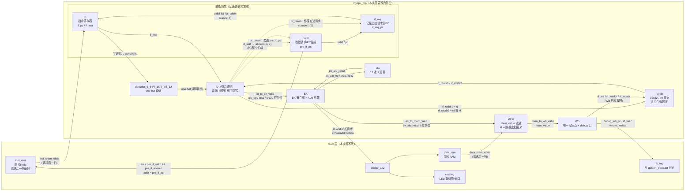

# exp8 五级流水 CPU（cancel + 阻塞）RTL 设计说明（附完整源码）

> 适用代码：`prj2/exp8/myCPU/` 下四个文件（`mycpu_top.v` / `alu.v` / `regfile.v` / `tools.v`）。
> 与提交包关系：`alu.v` / `regfile.v` / `tools.v` 与提交包逐字节一致；`mycpu_top.v` 工作区版带行尾中文注释（阅读版），代码本身与提交包一致，仅多注释。
> 功能验证：n1~n20 全 PASS，仿真用时 1349305 ns（日志见 `prj2/logs/exp8_run.log`、`prj2/logs/exp8_xsim_run.log`）。
> exp9 与本版唯一实质差异在数据冒险处理（阻塞 → 前递），其余完全相同；本文件只讲 exp8。

建议阅读顺序：§一 模块总览 → §二 各模块端口 → §三 怎么接 → §四 流水线信号计算 → §五 源码全文对照。

---

## 一、模块总览

```
tb_top（仿真顶层：提供 clk/resetn，逐条比对 golden_trace.txt）
└── soc_lite_top（SoC 顶层，SoC 层文件都在 soc_verify/soc_bram/ 下，本实验不改）
    ├── mycpu_top                       ← 本实验要写的 CPU（myCPU/ 下四个文件）
    │   ├── decoder_6_64 / 4_16 / 2_4 / 5_32   （tools.v，ID 译码用 one-hot 译码器）
    │   ├── regfile                            （32×32 寄存器堆，r0 恒 0）
    │   └── alu                                （12 选 1 运算单元）
    ├── inst_ram（同步 BRAM，上电从 func/obj/inst_ram.mif 加载；CPU 经 inst_sram_* 访问）
    ├── bridge_1x2（数据总线 1 分 2：按地址分给 data_ram / confreg）
    │   ├── data_ram（同步 BRAM，func/obj/data_ram.mif）
    │   └── confreg（LED/数码管/按键/串口/计时器，数码管停在 0x14000014 = 20 点全过）
    └── clk_pll（仿真时 SIMU_USE_PLL=0，cpu_clk 直接透传 clk）
```

CPU 内部流水线共 7 段（经典 5 段 + 取指侧因同步 RAM 多拆 2 段）：

```
preIF ──▶ if_req ──▶ IF ──▶ ID(组合) ──▶ EX ──▶ MEM ──▶ WB
取指请求    取指返回    指令寄存器   译码      运算     访存     写回
```

- `preIF`：每拍向 inst_sram 发一条取指请求（PC 生成器，也是分支改道点）。
- `if_req`：同步 RAM 一拍后才返回数据，这一级记住"上一拍请求的 PC"。
- `IF`：数据回来的那一拍，把 (PC, 指令) 成对收进指令寄存器。
- `ID`：**组合逻辑**，没有寄存器；对 `if_inst` 译码、读寄存器堆、判冒险。
- `EX / MEM / WB`：常规运算、访存、写回三级。

---

## 二、各模块输入输出

### 2.1 mycpu_top（顶层）

| 方向 | 信号 | 位宽 | 说明 |
|---|---|---|---|
| in | `clk` | 1 | 时钟（100 MHz） |
| in | `resetn` | 1 | 低有效复位；内部同步一拍转成高有效 `reset` |
| out | `inst_sram_en` | 1 | 取指 RAM 使能（= 有请求且未冻结） |
| out | `inst_sram_we` | 4 | 恒 0（只读） |
| out | `inst_sram_addr` | 32 | 取指地址 = `pre_if_pc` |
| out | `inst_sram_wdata` | 32 | 恒 0 |
| in | `inst_sram_rdata` | 32 | 一拍前请求的指令（同步 RAM 输出） |
| out | `data_sram_en` | 1 | 数据 RAM 使能（`ld.w`/`st.w` 在 EX 发请求） |
| out | `data_sram_we` | 4 | `st.w` 时为 `4'b1111`，否则 0（整字写） |
| out | `data_sram_addr` | 32 | 访存地址 = `ex_alu_result` |
| out | `data_sram_wdata` | 32 | 存数数据 = `ex_rkd_value` |
| in | `data_sram_rdata` | 32 | `ld.w` 数据（MEM 级有效） |
| out | `debug_wb_pc` | 32 | WB 级 PC（与 golden trace 比对） |
| out | `debug_wb_rf_we` | 4 | 写回使能 ×4 |
| out | `debug_wb_rf_wnum` | 5 | 写回目标寄存器号 |
| out | `debug_wb_rf_wdata` | 32 | 写回数据 |

### 2.2 regfile（寄存器堆）

| 方向 | 信号 | 位宽 | 说明 |
|---|---|---|---|
| in | `clk` | 1 | 写口时序 |
| in | `raddr1 / raddr2` | 5 | 两个读口地址（组合读） |
| out | `rdata1 / rdata2` | 32 | 读数据；地址为 0 时恒出 0（r0 硬连 0） |
| in | `we` | 1 | 写使能（高有效） |
| in | `waddr` | 5 | 写地址 |
| in | `wdata` | 32 | 写数据 |

要点：读口是**组合**的，当拍给地址当拍出数；写口在 `posedge clk` 且 `we=1` 时写入——所以 WB 拍末写回后，下一拍 ID 才读得到新值（阻塞冒险正是要等这个）。

### 2.3 alu（运算单元）

| 方向 | 信号 | 位宽 | 说明 |
|---|---|---|---|
| in | `alu_op` | 12 | one-hot 运算选择码（编码见 §4.3） |
| in | `alu_src1 / alu_src2` | 32 | 两操作数 |
| out | `alu_result` | 32 | 组合运算结果 |

实现要点：

- 加法器复用：`sub / slt / sltu` 时 `adder_b = ~alu_src2, cin = 1`（补码减法）。
- `slt`：`(|rj|<|rk|)` 用符号位 + 差的符号位判；`sltu`：直接取 `~cout`。
- 移位：`sll` 直接左移；`srl/sra` 用 64 位技巧——算术右移时把高 32 位拼满符号位再右移 `src2[4:0]` 位，取低 32 位。
- `lu12i.w`：`lui_result = alu_src2` 直通（立即数已在 ID 里移好位）。
- 输出是 12 路结果按 `alu_op` 位选或（one-hot mux）。

### 2.4 tools.v（四个 one-hot 译码器）

| 模块 | 输入 | 输出 | 逻辑 |
|---|---|---|---|
| `decoder_6_64` | `in[5:0]`（op_31_26） | `out[63:0]` | `out[i] = (in == i)` |
| `decoder_4_16` | `in[3:0]`（op_25_22） | `out[15:0]` | 同上 |
| `decoder_2_4` | `in[1:0]`（op_21_20） | `out[3:0]` | 同上 |
| `decoder_5_32` | `in[4:0]`（op_19_15） | `out[31:0]` | 同上 |

用途：指令译码。指令判定式形如 `inst_add_w = op_31_26_d[6'h00] & op_25_22_d[4'h0] & op_21_20_d[2'h1] & op_19_15_d[5'h00]`，四个译码器各管一个字段，按位与即得该指令的 one-hot。

### 2.5 SoC 层（不改，但要懂时序）

- `soc_lite_top` 把 `resetn` 打一拍成 `cpu_resetn` 再给 CPU；仿真时 `cpu_clk = clk`。
- `inst_ram` / `data_ram` 都是 `sync_ram` 模型：**`rdata` 在 `en=1` 的下一拍才更新**。CPU 因此把取指拆成 preIF（发请求）/ if_req（记 PC）/ IF（收数据）三级；`ld.w` 的读请求在 EX 发，数据正好在 MEM 级回来。
- `inst_ram` 用 `cpu_inst_addr[19:2]` 作地址；`data_ram` 用 `data_sram_addr[17:2]`。
- `tb_top` 在 `posedge clk` 把 `debug_wb_*` 与 `gettrace/golden_trace.txt` 逐条比对（PC、写寄存器号、写数据），全对输出 `----PASS!!!`，错一条 `Error!!!`。所以"功能正确"的唯一标准就是 WB 级提交流与参考流一致。

---

## 三、模块怎么接的（CPU 内部数据通路）



> 上图说明：实线 = 数据通路（每拍向前流动的数据），虚线 = 冒险反馈（分支改道/作废、停顿反压）。本图用 Mermaid 绘制，需要支持 Mermaid 的 Markdown 查看器（VS Code 装 Markdown Preview Mermaid Support / Typora / Obsidian / GitHub 均可）。

逐条说明：

1. **寄存器堆读口 ← ID**：`rf_raddr1 = rj`；`rf_raddr2 = src_reg_is_rd ? rd : rk`（只有 `beq/bne/st.w` 的第二源在 rd 字段）。
2. **寄存器堆写口 ← WB**：`rf_we = wb_gr_we && wb_valid`、`rf_waddr = wb_dest`、`rf_wdata = wb_value`。全流水线只有这一个写点。
3. **alu ← EX 寄存器**：EX 级寄存器打拍存下 `alu_op / alu_src1 / alu_src2`，alu 组合算出 `ex_alu_result`，既作为访存地址/存数数据，也随流水线进 MEM/WB。
4. **inst_sram ← preIF**：取指请求由最前级发，`en` 带冻结条件保证 RAM 的寄存输出永远与 `if_req_pc` 一一对应。
5. **data_sram ← EX**：`ld.w/st.w` 在 EX 发请求；同步 RAM 一拍后返回 → 读数据在 MEM 级采样。
6. **分支反馈（控制冒险）**：ID 算出 `br_taken/br_target` 后，一条改道 `pre_if_pc`，两条作废 if_req/IF 里的错路径指令。
7. **停顿反压（数据冒险）**：ID 算出 `id_stall`，经 `id_allowin → if_allowin → if_req_allowin → pre_if_allowin` 一条链冻住整个前端；EX/MEM/WB 照常前进。
8. **译码器 ← ID**：四个 one-hot 译码器接指令字段切片，输出供指令判定。

---

## 四、流水线阶段信号怎么算

### 4.1 流水线控制通用件：valid / ready_go / allowin

每级寄存器都配一组三件套（以 EX 为例）：

```verilog
wire ex_ready_go  = 1'b1;                                   // 本级当拍能算完
wire ex_allowin   = !ex_valid || (ex_ready_go && mem_allowin); // 本级能否被更新
wire ex_to_mem_valid = ex_valid && ex_ready_go;             // 是否有有效数据传给下一级
```

- `allowin = 1` 时本级寄存器在时钟沿更新；`allowin = 0` 时保持（停住）。
- 本设计所有级 `ready_go = 1`（每级一拍），**唯一停顿源是 ID 的 `id_stall`**，靠 allowin 链反向传播。
- ID 没有寄存器，只有 `id_ready_go = ~id_stall` 和 `id_to_ex_valid = if_valid && id_ready_go`。

各阶段寄存器的更新公式总表（`<=` 表示时钟沿非阻塞赋值，`复位` 指 `reset` 高电平期间）：

| 阶段 | ready_go | allowin | valid 的 next | 数据的 next |
|---|---|---|---|---|
| preIF | 1 | `!pre_if_valid \|\| if_req_allowin` | 复位 0；allowin 时置 1（此后恒 1） | `pre_if_pc`：复位 `32'h1bfffffc`；allowin 时 `br_taken ? br_target : pre_if_pc+4` |
| if_req | 1 | `!if_req_valid \|\| if_allowin` | 复位 0；allowin 时 `pre_if_valid && !br_taken` | `if_req_pc`：复位 `32'h1bfffffc`；`allowin && pre_if_valid && !br_taken` 时 `pre_if_pc` |
| IF | 1 | `!if_valid \|\| id_allowin` | 复位 0；allowin 时 `if_req_valid && !br_taken` | `if_pc/if_inst`：`allowin && if_req_valid && !br_taken` 时 `{if_req_pc, inst_sram_rdata}` |
| ID | `~id_stall` | `!if_valid \|\| (id_ready_go && ex_allowin)` | 组合级：`id_to_ex_valid = if_valid && id_ready_go` | — |
| EX | 1 | `!ex_valid \|\| mem_allowin` | 复位 0；allowin 时 `id_to_ex_valid` | `id_to_ex_valid && ex_allowin` 时打拍 `{if_pc, alu_op, src1, src2, rkd, gr_we, mem_we, res_from_mem, dest}` |
| MEM | 1 | `!mem_valid \|\| wb_allowin` | 复位 0；allowin 时 `ex_to_mem_valid` | `ex_to_mem_valid && mem_allowin` 时打拍 `{ex_pc, ex_alu_result, ex_gr_we, ex_res_from_mem, ex_dest}` |
| WB | 1 | `!wb_valid \|\| 1`（恒 1） | 复位 0；allowin 时 `mem_to_wb_valid` | `mem_to_wb_valid && wb_allowin` 时打拍 `{mem_pc, mem_gr_we, mem_dest, mem_value}` |

注意三个细节：

- `if_allowin` 在公式里引用的是 `id_allowin`（IF 的下游是 ID），停顿时一拍传一级。
- EX/MEM/WB 的 valid 更新不要求 `!br_taken`——指令一旦进了 EX 就**不会**被取消，只有 IF/if_req 里的错路径指令被取消。
- 停顿时 `id_to_ex_valid = 0`，EX 收进来的是气泡（valid=0），而已在 EX/MEM/WB 的指令照常向下一级流动。

### 4.2 同步 RAM 与取指两级（preIF + if_req）的时序

`sync_ram` 的读是寄存的：T 拍 `en=1, addr=A`，T+1 拍 `rdata = mem[A]`。于是：

- **preIF**（T 拍）：发请求 `inst_sram_en = pre_if_valid && pre_if_allowin`，`addr = pre_if_pc`。
- **if_req**（T 拍末）：记下本拍请求的 PC：`if_req_pc <= pre_if_pc`。
- **IF**（T+1 拍）：数据恰好回到 `inst_sram_rdata`，与 `if_req_pc` 成对收进 `if_pc / if_inst`。

`inst_sram_en` 里带 `pre_if_allowin` 的原因：**冻结期不发新请求**，RAM 的寄存输出就停在"上一次请求"的数据上，保证停顿解除后 `if_req_pc` 与 `inst_sram_rdata` 仍然配对，不会错位。

复位 PC 的细节：复位入口是 `0x1c000000`，寄存器初值却写成 `0x1bfffffc`（入口 −4）。复位解除后的第一个时钟沿 `pre_if_pc <= pre_if_pc + 4` 才变成 `0x1c000000`，正好让**第一条真正发出的请求**指向入口。

### 4.3 ID 译码与关键控制信号

字段切片（`if_inst` 的位段）：

| 字段 | 位置 | 说明 |
|---|---|---|
| `rd` | [4:0] | 多数指令的目标；`beq/bne/st.w` 的第二源 |
| `rj` | [9:5] | 第一源（基址/被比较方/加数） |
| `rk` | [14:10] | 第二源（仅 3R 型）；移位指令借它放 5 位移位量 |
| `i12` | [21:10] | 12 位有符号立即数（addi.w/ld.w/st.w），覆盖 rk 位段 |
| `i16` | [25:10] | 16 位有符号立即数（beq/bne/jirl 偏移） |
| `i20` | [24:5] | 20 位立即数（lu12i.w），覆盖 rj+rk 位段 |
| `i26` | {[9:0],[25:10]} | 26 位立即数（b/bl 偏移），覆盖 rj+rk 位段 |

指令判定（译码器输出按位与，20 条指令）：

| 指令 | 判定式（op31_26 / op25_22 / op21_20 / op19_15） |
|---|---|
| `add_w` | `0x00 / 0x0 / 0x1 / 0x00` | `sub_w` 同前但 0x02 | `slt` 0x04 | `sltu` 0x05 |
| `nor` 0x08 | `and` 0x09 | `or` 0x0a | `xor` 0x0b |
| `slli_w` | `0x00 / 0x1 / 0x0 / 0x01` | `srli_w` 0x09 | `srai_w` 0x11 |
| `addi_w` | `0x00 / 0xa` | `ld_w` `0x0a / 0x2` | `st_w` `0x0a / 0x6` |
| `jirl` | `0x13` | `b` `0x14` | `bl` `0x15` | `beq` `0x16` | `bne` `0x17` |
| `lu12i_w` | `0x05 && ~if_inst[25]` |

`alu_op` 编码（bit → 运算 → 来源指令）：

| bit | 运算 | 来源 |
|---|---|---|
| 0 | add | `add_w / addi_w / ld_w / st_w / jirl / bl` |
| 1 | sub | `sub_w` |
| 2 / 3 | slt / sltu | `slt / sltu` |
| 4 / 5 / 6 / 7 | and / nor / or / xor | 同名指令 |
| 8 / 9 / 10 | sll / srl / sra | `slli_w / srli_w / srai_w` |
| 11 | lui | `lu12i_w` |

立即数 mux：

```verilog
assign imm = src2_is_4 ? 32'h4                  :   // jirl/bl 的 +4（返回地址）
             need_si20 ? {i20[19:0], 12'b0}     :   // lu12i.w 高 20 位
             need_ui5  ? {27'd0, rk}            :   // 移位数（无符号 5 位）
                         {{20{i12[11]}}, i12};  // si12 符号扩展
assign br_offs   = need_si26 ? {{4{i26[25]}}, i26, 2'b0}      // b/bl：符号扩展 <<2
                             : {{14{i16[15]}}, i16, 2'b0};   // beq/bne：si16 <<2
assign jirl_offs = {{14{i16[15]}}, i16, 2'b0};                // jirl 偏移
```

关键控制信号：

| 信号 | 公式 | 含义 |
|---|---|---|
| `src_reg_is_rd` | `beq \| bne \| st_w` | 第二源在 rd 字段 |
| `src1_is_pc` | `jirl \| bl` | 第一操作数是 PC（算返回地址 PC+4） |
| `src2_is_imm` | 移位/addi/ld/st/lu12i/jirl/bl | 第二操作数是立即数 |
| `res_from_mem` | `ld_w` | 结果来自存储器 |
| `dst_is_r1` | `bl` | bl 固定写 r1 |
| `gr_we` | `~st_w & ~beq & ~bne & ~b` | 写寄存器使能 |
| `mem_we` | `st_w` | 写存储器 |
| `dest` | `bl ? 5'd1 : rd` | 写目标号 |
| `id_uses_rj` | `~(b \| bl \| lu12i_w)` | 本条真读 rj？（其余都读） |
| `id_uses_rkd` | 3R 运算 + `beq/bne/st_w` | 本条真读第二源寄存器？ |
| `id_src2_reg` | `src_reg_is_rd ? rd : rk` | 第二源寄存器号 |

`id_uses_rj / id_uses_rkd` 的作用：冒险检测**只比对真读的寄存器**，否则会把立即数位段误当成寄存器号（例如 `addi.w` 的 rk 位其实是 i12 的高 5 位）。

### 4.4 数据冒险【阻塞】：检测公式与停顿拍数

检测三要素（以 EX 为例）：**EX 有指令 && 它要写寄存器 && 目标非 r0 && 目标号 == 本条要读的源号**：

```verilog
wire id_ex_hit  = ex_valid  && ex_gr_we  && (ex_dest  != 5'b0)
               && ( (id_uses_rj && (ex_dest  == rj)) || (id_uses_rkd && (ex_dest  == id_src2_reg)) );
wire id_mem_hit = mem_valid && mem_gr_we && (mem_dest != 5'b0)
               && ( (id_uses_rj && (mem_dest == rj)) || (id_uses_rkd && (mem_dest == id_src2_reg)) );
wire id_wb_hit  = wb_valid  && wb_gr_we  && (wb_dest  != 5'b0)
               && ( (id_uses_rj && (wb_dest  == rj)) || (id_uses_rkd && (wb_dest  == id_src2_reg)) );

wire id_stall = if_valid && (id_ex_hit || id_mem_hit || id_wb_hit);
```

- 三路任一路命中 → `id_stall = 1` → `id_ready_go = 0` → `id_to_ex_valid = 0`（EX 收气泡）。
- 反压链：`id_allowin = !if_valid || (id_ready_go && ex_allowin)` = 0 → `if_allowin` = 0 → `if_req_allowin` = 0 → `pre_if_allowin` = 0：**IF 及更上游全冻住**，本条指令停在 IF 寄存器里被反复译码，等待。
- `id_stall` 串 `if_valid`：IF 为空时（气泡）不瞎停。
- 生产者照常前进：EX→MEM→WB→写回，消费者等它写进寄存器堆。

停顿拍数 = 生产者离 WB 的距离：

| 生产者在 | 要等 | 原因 |
|---|---|---|
| EX | 3 拍 | 走 MEM、WB 各一拍，WB 拍末写回 |
| MEM | 2 拍 | 走 WB 一拍，WB 拍末写回 |
| WB | 1 拍 | 本拍末写回，下一拍读得到 |

逐拍例子（`add.w r4, r1, r2` 之后 `add.w r3, r4, r5`）：

```
拍      IF(ID)     EX        MEM       WB        rf 写     动作
T       C(消费者)  P(生产者) -         -         -         id_ex_hit → 停
T+1     C          气泡      P         -         -         id_mem_hit → 停
T+2     C          气泡      气泡      P         -         id_wb_hit → 停
T+3     C          气泡      气泡      气泡      rf[4]     ← 写回；无命中，解除停顿
T+4     (下一条)   C         ...                            C 进 EX，读到新值
```

共插入 3 个气泡（T+1~T+3）。`ld.w` 的 load-use 也一样被这套检测覆盖（`ld.w` 同样 `gr_we=1, dest=rd`），只是多等一拍访存。

### 4.5 控制冒险【cancel】：分支判定与四个处理点

分支在 ID 判定（比 EX 判少 1 拍代价）：

```verilog
wire rj_eq_rd = (id_rj_value == id_rkd_value);          // 比较用寄存器堆旧值
wire br_taken = ((inst_beq &&  rj_eq_rd) || (inst_bne && !rj_eq_rd)
              || inst_jirl || inst_bl || inst_b) && if_valid && ~id_stall;
wire br_target = (inst_beq||inst_bne||inst_bl||inst_b) ? (if_pc + br_offs)
                                                        : (id_rj_value + jirl_offs); // jirl
```

- `~id_stall` 是**安全阀**：分支操作数的生产者在途时一定在停（§4.4），此时不许判分支，否则会拿寄存器堆里的旧值误判 taken/not-taken。
- `b/bl/beq/bne` 目标 = PC 相对；`jirl` 目标 = 寄存器相对，同时 EX 算 PC+4 写回 rd（返回地址）。

taken 时四个处理点（作废两条错路径指令 + 改道）：

| 点 | 位置 | 公式 | 作用 |
|---|---|---|---|
| cancel ① | `if_req_valid` next | `pre_if_valid && !br_taken` | 作废"已在途"（if_req 里）的那条 |
| cancel ② | `if_req_pc` 更新条件 | `allowin && pre_if_valid && !br_taken` | 不把错路径 PC 写进 if_req_pc |
| cancel ③ | `if_req_to_if_valid` | `if_req_valid && !br_taken` | IF 下一拍收气泡（拦住刚回数据那条） |
| cancel ④ | `pre_if_pc` next | `br_taken ? br_target : pre_if_pc+4` | 下一拍改道目标地址 |

逐拍例子（`beq` taken，B 在 ID，B+4 在 if_req，B+8 是当前正在发的请求）：

```
拍 T     ：B 在 ID 判定 taken
          → ① if_req_valid_next = 0（作废 B+4）
          → ④ pre_if_pc_next = br_target
拍 T+1   ：B 进 EX；IF 收气泡（③）；preIF 从 br_target 重新取指
          → 本拍回来的 B+8 数据被丢弃（if_req 已空）
拍 T+2   ：目标地址指令流重新充满前端
```

taken 分支的代价 = 2 条（if_req 里 1 条 + 正在途 1 条）；not-taken 零代价。

### 4.6 EX / MEM / WB 的数据计算

**EX**（寄存器打拍 + 组合 ALU）：

```verilog
ex_alu_src1 <= src1_is_pc ? if_pc : id_rj_value;   // bl/jirl 的第一操作数是 PC
ex_alu_src2 <= src2_is_imm ? imm : id_rkd_value;   // 立即数或第二源
ex_rkd_value<= id_rkd_value;                       // st.w 的存数数据随流水线走
// 还有 ex_pc / ex_alu_op / ex_gr_we / ex_mem_we / ex_res_from_mem / ex_dest 一起打拍
assign ex_alu_result = alu(ex_alu_op, ex_alu_src1, ex_alu_src2);   // 组合
```

访存请求在 EX 发（同步 RAM 一拍后返回，正好落在 MEM 级）：

```verilog
assign data_sram_en    = ex_valid && (ex_mem_we || ex_res_from_mem);
assign data_sram_we    = ex_mem_we ? 4'b1111 : 4'b0000;   // 整字写
assign data_sram_addr  = ex_alu_result;
assign data_sram_wdata = ex_rkd_value;
```

**MEM**：

```verilog
assign mem_value = mem_res_from_mem ? data_sram_rdata : mem_alu_result;
// ld.w 的数据这一拍才有效（请求是上一拍在 EX 发的）；其余指令直通 ALU 结果
```

**WB**（唯一写回点 + 调试口）：

```verilog
assign rf_we    = wb_gr_we && wb_valid;
assign rf_waddr = wb_dest;
assign rf_wdata = wb_value;
assign debug_wb_pc = wb_pc;  debug_wb_rf_we = {4{rf_we}};
assign debug_wb_rf_wnum = wb_dest;  debug_wb_rf_wdata = wb_value;
```

### 4.7 复位

- `reset <= ~resetn`：外部低有效复位同步一拍成内部高有效（SoC 层还另打了一拍）。
- 复位时：所有 `*_valid` 清 0；`pre_if_pc / if_req_pc / if_pc` 置 `32'h1bfffffc`（入口 −4，见 §4.2）；其余数据寄存器清 0。
- 复位解除后前端自动从 `0x1c000000` 开始取指，流水线逐级灌满。

---

## 五、附录：完整源码

### 5.1 mycpu_top.v（工作区阅读版，行尾带中文注释；代码与提交包一致）

```verilog
// ============================================================================
// 5-stage pipelined LoongArch LA32R CPU (preIF -> IF -> ID -> EX -> MEM -> WB)
// Experiment: exp8 pipeline CPU (cancel for control hazards, blocking for data)
//  - data hazard : ID blocks until the producer has written back the regfile
//  - control hazard : branch resolved in ID; taken branch cancels the
//                     wrong-path insts in if_req/IF and redirects the PC
//  - inst/data RAM : synchronous read model (rdata returns one cycle after the
//                    request), matching the soc_bram sync_ram / BRAM flow
// ============================================================================
// ---------------------------------------------------------------------------
// 本版要点：数据冒险用【阻塞 block】、控制冒险用【取消 cancel】。
// 下面每行右侧的中文就是该行的作用，标了【阻塞】【cancel】的即两类冒险的处理点：
//   【阻塞】ID 要读的源与在途(EX / MEM / WB)写目标撞车 → 冻住 ID 及上游，等 WB 拍末写回
//   【cancel】分支在 ID 判定 taken → 作废已错取的两条 + 改道 pre_if_pc
// ---------------------------------------------------------------------------
module mycpu_top(
    input  wire        clk,
    input  wire        resetn,
    // inst sram interface
    output wire        inst_sram_en,
    output wire [3:0]  inst_sram_we,
    output wire [31:0] inst_sram_addr,
    output wire [31:0] inst_sram_wdata,
    input  wire [31:0] inst_sram_rdata,
    // data sram interface
    output wire        data_sram_en,
    output wire [3:0]  data_sram_we,
    output wire [31:0] data_sram_addr,
    output wire [31:0] data_sram_wdata,
    input  wire [31:0] data_sram_rdata,
    // trace debug interface
    output wire [31:0] debug_wb_pc,
    output wire [ 3:0] debug_wb_rf_we,
    output wire [ 4:0] debug_wb_rf_wnum,
    output wire [31:0] debug_wb_rf_wdata
);

reg reset;
always @(posedge clk) reset <= ~resetn;   // 复位同步一拍，reset 高有效

// ============================ preIF fetch request ============================
reg         pre_if_valid;   // preIF 级 valid：本轮要发的取指请求
reg  [31:0] pre_if_pc;   // preIF 级的请求地址（inst_sram_addr 直接用它）

wire pre_if_ready_go = 1'b1;   // preIF / if_req 两级都一拍完成
wire if_req_ready_go = 1'b1;

// if_req keeps a one-cycle-delayed copy of the fetch PC.  The synchronous
// inst RAM returns the instruction one cycle after the request, so IF samples
// (if_req_pc, inst_sram_rdata) in the cycle the data comes back.
wire if_req_allowin = !if_req_valid || (if_req_ready_go && if_allowin);   // 【握手】下游 IF 肯收、或本级为空，才允许更新 —— 数据冒险的停顿就靠这条链传上来
wire pre_if_allowin = !pre_if_valid || (pre_if_ready_go && if_req_allowin);   // 【前端反压链最上游】id_allowin 一拉低这里就变 0，pre_if_pc 不再更新

always @(posedge clk) begin
    if (reset) begin
        pre_if_valid <= 1'b0;
    end
    else if (pre_if_allowin) begin
        pre_if_valid <= 1'b1;   // valid 置 1 后一直保持（取指不中断）
    end
end

always @(posedge clk) begin
    if (reset) begin
        pre_if_pc <= 32'h1bfffffc;  // reset entry is 0x1c000000; pre-load entry-4 so the
                                // first fetch request after reset targets the entry
    end
    else if (pre_if_allowin) begin
        if (br_taken) pre_if_pc <= br_target;   // 【cancel ④ 改道】分支 taken：下一拍改取 br_target（不撤销本拍已发出的请求）
        else          pre_if_pc <= pre_if_pc + 32'd4;   // 顺序取指：PC + 4
    end
end

// Fetch only while the front end advances, so that the RAM's registered output
// always corresponds to the PC captured by if_req.
assign inst_sram_en    = pre_if_valid && pre_if_allowin;   // 【冻结期不发请求】保证 RAM 的寄存输出与 if_req_pc 一一对应 → 停顿时取指不错位
assign inst_sram_we    = 4'b0000;
assign inst_sram_addr  = pre_if_pc;   // 取指请求地址 = pre_if_pc
assign inst_sram_wdata = 32'b0;

// ====================== fetch-return (if_req) stage =======================
reg         if_req_valid;
reg  [31:0] if_req_pc;

always @(posedge clk) begin
    if (reset) begin
        if_req_valid <= 1'b0;
    end
    else if (if_req_allowin) begin
        if_req_valid <= pre_if_valid && !br_taken;   // 【cancel ①】分支 taken 当拍：不再接收这一拍正发出去的错路径请求
    end
end

always @(posedge clk) begin
    if (reset) begin
        if_req_pc <= 32'h1bfffffc;
    end
    else if (if_req_allowin && pre_if_valid && !br_taken) begin   // 【cancel ②】同上：不把错路径 PC 写进 if_req_pc（否则下一拍 PC 与数据配错）
        if_req_pc <= pre_if_pc;   // → if_req_pc 在 cancel 那拍保持不动
    end
end

// =============================== IF stage ================================
reg         if_valid;
reg  [31:0] if_pc;
reg  [31:0] if_inst;

wire if_ready_go = 1'b1;
wire if_allowin  = !if_valid || (if_ready_go && id_allowin);   // 【握手】IF 的下游是 ID：ID 一停，IF 跟着停
// cancel the wrong-path instruction queued behind a taken branch
wire if_req_to_if_valid = if_req_valid && !br_taken;   // 【cancel ③】拦住"上一拍已受理、这拍数据刚从 RAM 回来"的那条错路径指令

always @(posedge clk) begin
    if (reset) begin
        if_valid <= 1'b0;
    end
    else if (if_allowin) begin
        if_valid <= if_req_to_if_valid;   // 错路径那拍 if_req_to_if_valid=0 → IF 进来一个空泡
    end
end

always @(posedge clk) begin
    if (reset) begin
        if_pc <= 32'h1bfffffc;
    end
    else if (if_allowin && if_req_to_if_valid) begin
        if_pc <= if_req_pc;   // PC 与指令数据同拍对齐
    end
end

always @(posedge clk) begin
    if (reset) begin
        if_inst <= 32'h0;
    end
    else if (if_allowin && if_req_to_if_valid) begin
        if_inst <= inst_sram_rdata;   // 同步 RAM：这一拍的数据对应 if_req_pc
    end
end

// =========================== ID decode (combinational) =======================
wire [ 5:0] op_31_26;
wire [ 3:0] op_25_22;
wire [ 1:0] op_21_20;
wire [ 4:0] op_19_15;
wire [ 4:0] rd;
wire [ 4:0] rj;
wire [ 4:0] rk;
wire [11:0] i12;
wire [19:0] i20;
wire [15:0] i16;
wire [25:0] i26;

wire [63:0] op_31_26_d;
wire [15:0] op_25_22_d;
wire [ 3:0] op_21_20_d;
wire [31:0] op_19_15_d;

wire        inst_add_w;
wire        inst_sub_w;
wire        inst_slt;
wire        inst_sltu;
wire        inst_nor;
wire        inst_and;
wire        inst_or;
wire        inst_xor;
wire        inst_slli_w;
wire        inst_srli_w;
wire        inst_srai_w;
wire        inst_addi_w;
wire        inst_ld_w;
wire        inst_st_w;
wire        inst_jirl;
wire        inst_b;
wire        inst_bl;
wire        inst_beq;
wire        inst_bne;
wire        inst_lu12i_w;

wire        need_ui5;
wire        need_si12;
wire        need_si16;
wire        need_si20;
wire        need_si26;
wire        src2_is_4;

wire [11:0] alu_op;
wire        src1_is_pc;
wire        src2_is_imm;
wire        res_from_mem;
wire        dst_is_r1;
wire        gr_we;
wire        mem_we;
wire        src_reg_is_rd;
wire [ 4:0] dest;
wire [31:0] imm;
wire [31:0] br_offs;
wire [31:0] jirl_offs;

assign op_31_26  = if_inst[31:26];   // 字段切分：op / rd / rj / rk / 各种立即数（立即数会占住 rj、rk 的位置）
assign op_25_22  = if_inst[25:22];
assign op_21_20  = if_inst[21:20];
assign op_19_15  = if_inst[19:15];

assign rd   = if_inst[ 4: 0];   // rd：多数指令是目标；beq / bne / st.w 里它是第二源
assign rj   = if_inst[ 9: 5];   // rj：第一源（基址 / 被比较的一方 / 加数）
assign rk   = if_inst[14:10];   // rk：第二源（仅 3R 型）；移位指令的移位量也放这里，但那是位段不是寄存器

assign i12  = if_inst[21:10];   // i12 覆盖 rk 的位置
assign i20  = if_inst[24: 5];   // i20 覆盖 rj 和 rk 的位置（lu12i.w）
assign i16  = if_inst[25:10];
assign i26  = {if_inst[ 9: 0], if_inst[25:10]};   // i26 覆盖 rj 和 rk 的位置（b / bl）

decoder_6_64 u_dec0(.in(op_31_26 ), .out(op_31_26_d ));
decoder_4_16 u_dec1(.in(op_25_22 ), .out(op_25_22_d ));
decoder_2_4  u_dec2(.in(op_21_20 ), .out(op_21_20_d ));
decoder_5_32 u_dec3(.in(op_19_15 ), .out(op_19_15_d ));

assign inst_add_w  = op_31_26_d[6'h00] & op_25_22_d[4'h0] & op_21_20_d[2'h1] & op_19_15_d[5'h00];
assign inst_sub_w  = op_31_26_d[6'h00] & op_25_22_d[4'h0] & op_21_20_d[2'h1] & op_19_15_d[5'h02];
assign inst_slt    = op_31_26_d[6'h00] & op_25_22_d[4'h0] & op_21_20_d[2'h1] & op_19_15_d[5'h04];
assign inst_sltu   = op_31_26_d[6'h00] & op_25_22_d[4'h0] & op_21_20_d[2'h1] & op_19_15_d[5'h05];
assign inst_nor    = op_31_26_d[6'h00] & op_25_22_d[4'h0] & op_21_20_d[2'h1] & op_19_15_d[5'h08];
assign inst_and    = op_31_26_d[6'h00] & op_25_22_d[4'h0] & op_21_20_d[2'h1] & op_19_15_d[5'h09];
assign inst_or     = op_31_26_d[6'h00] & op_25_22_d[4'h0] & op_21_20_d[2'h1] & op_19_15_d[5'h0a];
assign inst_xor    = op_31_26_d[6'h00] & op_25_22_d[4'h0] & op_21_20_d[2'h1] & op_19_15_d[5'h0b];
assign inst_slli_w = op_31_26_d[6'h00] & op_25_22_d[4'h1] & op_21_20_d[2'h0] & op_19_15_d[5'h01];
assign inst_srli_w = op_31_26_d[6'h00] & op_25_22_d[4'h1] & op_21_20_d[2'h0] & op_19_15_d[5'h09];
assign inst_srai_w = op_31_26_d[6'h00] & op_25_22_d[4'h1] & op_21_20_d[2'h0] & op_19_15_d[5'h11];
assign inst_addi_w = op_31_26_d[6'h00] & op_25_22_d[4'ha];
assign inst_ld_w   = op_31_26_d[6'h0a] & op_25_22_d[4'h2];
assign inst_st_w   = op_31_26_d[6'h0a] & op_25_22_d[4'h6];
assign inst_jirl   = op_31_26_d[6'h13];
assign inst_b      = op_31_26_d[6'h14];   // b：无条件跳转，不读寄存器、不写寄存器
assign inst_bl     = op_31_26_d[6'h15];   // bl：跳转 + 链接，返回地址写 r1
assign inst_beq    = op_31_26_d[6'h16];
assign inst_bne    = op_31_26_d[6'h17];
assign inst_lu12i_w= op_31_26_d[6'h05] & ~if_inst[25];   // lu12i.w：把 20 位立即数装进 rd 高位（低 12 位补 0）

assign alu_op[ 0] = inst_add_w | inst_addi_w | inst_ld_w | inst_st_w
                    | inst_jirl | inst_bl;
assign alu_op[ 1] = inst_sub_w;
assign alu_op[ 2] = inst_slt;
assign alu_op[ 3] = inst_sltu;
assign alu_op[ 4] = inst_and;
assign alu_op[ 5] = inst_nor;
assign alu_op[ 6] = inst_or;
assign alu_op[ 7] = inst_xor;
assign alu_op[ 8] = inst_slli_w;
assign alu_op[ 9] = inst_srli_w;
assign alu_op[10] = inst_srai_w;
assign alu_op[11] = inst_lu12i_w;

assign need_ui5   =  inst_slli_w | inst_srli_w | inst_srai_w;   // 移位的第二操作数是 5 位立即数（借 rk 字段承载），不算"读寄存器"
assign need_si12  =  inst_addi_w | inst_ld_w | inst_st_w;   // si12 立即数：addi.w / ld.w / st.w
assign need_si16  =  inst_jirl | inst_beq | inst_bne;
assign need_si20  =  inst_lu12i_w;
assign need_si26  =  inst_b | inst_bl;
assign src2_is_4  =  inst_jirl | inst_bl;   // jirl / bl 的第二操作数是常数 4

assign imm = src2_is_4 ? 32'h4                      :
             need_si20 ? {i20[19:0], 12'b0}         :
             need_ui5  ? {27'd0, rk}                :
                         {{20{i12[11]}}, i12[11:0]};   // need_si12: sign-extended i12

assign br_offs = need_si26 ? {{ 4{i26[25]}}, i26[25:0], 2'b0} :
                             {{14{i16[15]}}, i16[15:0], 2'b0} ;

assign jirl_offs = {{14{i16[15]}}, i16[15:0], 2'b0};

assign src_reg_is_rd = inst_beq | inst_bne | inst_st_w;   // 第二源落在 rd 还是 rk：只有 beq / bne / st.w 用 rd

assign src1_is_pc    = inst_jirl | inst_bl;

assign src2_is_imm   = inst_slli_w |
                       inst_srli_w |
                       inst_srai_w |
                       inst_addi_w |
                       inst_ld_w   |
                       inst_st_w   |
                       inst_lu12i_w|
                       inst_jirl   |
                       inst_bl     ;

assign res_from_mem  = inst_ld_w;
assign dst_is_r1     = inst_bl;
assign gr_we         = ~inst_st_w & ~inst_beq & ~inst_bne & ~inst_b;   // 写寄存器使能：st.w / beq / bne / b 不写
assign mem_we        = inst_st_w;
assign dest          = dst_is_r1 ? 5'd1 : rd;   // 写目标号：bl 固定写 r1

// regfile read ports
wire [ 4:0] rf_raddr1;
wire [31:0] rf_rdata1;
wire [ 4:0] rf_raddr2;
wire [31:0] rf_rdata2;
wire        rf_we   ;
wire [ 4:0] rf_waddr;
wire [31:0] rf_wdata;

assign rf_raddr1 = rj;   // 寄存器堆读口 1 地址 = rj（永远是第一源）
assign rf_raddr2 = src_reg_is_rd ? rd : rk;   // 读口 2 地址 = rd 或 rk

regfile u_regfile(
    .clk    (clk      ),
    .raddr1 (rf_raddr1),
    .rdata1 (rf_rdata1),
    .raddr2 (rf_raddr2),
    .rdata2 (rf_rdata2),
    .we     (rf_we    ),
    .waddr  (rf_waddr ),
    .wdata  (rf_wdata )
    );

// whether the source register is actually used
wire id_uses_rj  = ~(inst_b | inst_bl | inst_lu12i_w);   // 除 b / bl / lu12i.w 之外都读 rj（这三条的 rj 位其实是立即数的一部分）
wire id_uses_rkd = inst_add_w | inst_sub_w | inst_slt | inst_sltu   // 只有这些指令有第二源 → 冒险检测只在这两个标志为 1 时比对，否则会拿立即数位段当寄存器号
                 | inst_and | inst_or | inst_nor | inst_xor
                 | inst_beq | inst_bne | inst_st_w;

// ---- exp7 stage: no forwarding, operands come straight from the regfile ----
wire [31:0] ex_alu_result;   // EX stage ALU result (combinational)
wire [31:0] mem_value;       // MEM stage result
wire [31:0] wb_result;       // WB stage result

wire [31:0] id_rj_value  = rf_rdata1;   // 【本版无前递】第一源直接来自寄存器堆，可能还是旧值
wire [31:0] id_rkd_value = rf_rdata2;   // 【本版无前递】第二源（rkd = rk 或 rd）同样直接来自寄存器堆

// ---- branch resolved in ID ----
wire rj_eq_rd = (id_rj_value == id_rkd_value);   // 分支比较结果（beq 判相等、bne 判不等）
wire br_taken = (   (inst_beq && rj_eq_rd)   // 分支在 ID 拍就判定完（越早代价越小）
                 || (inst_bne && !rj_eq_rd)
                 || inst_jirl
                 || inst_bl
                 || inst_b
                ) && if_valid && ~id_stall;   // 【要点】源操作数没就绪就不许判分支，否则会拿旧值误判 taken / not-taken
wire [31:0] br_target;
assign br_target = (inst_beq || inst_bne || inst_bl || inst_b) ? (if_pc + br_offs) :   // 分支目标 = if_pc + 偏移
                                                    /*inst_jirl*/ (id_rj_value + jirl_offs);   // jirl：目标用寄存器值算（id_rj_value + 偏移）

// ---- data hazard: block ID until the producer has written the regfile ----
wire [4:0] id_src2_reg = src_reg_is_rd ? rd : rk;   // 【阻塞】本条指令第二源的寄存器号：3R 取 rk，beq / bne / st.w 取 rd

wire id_ex_hit  = ex_valid  && ex_gr_we  && (ex_dest  != 5'b0)   // 【阻塞 ① EX 撞车】生产者在 EX → 最坏，要等 3 拍（EX / MEM / WB 各一拍）
               && ( (id_uses_rj && (ex_dest  == rj)) || (id_uses_rkd && (ex_dest  == id_src2_reg)) );   // 三要素：那级有指令且要写寄存器 + 目标非 r0 + 目标号 == 本条要读的源号
wire id_mem_hit = mem_valid && mem_gr_we && (mem_dest != 5'b0)   // 【阻塞 ② MEM 撞车】生产者在 MEM → 等 2 拍
               && ( (id_uses_rj && (mem_dest == rj)) || (id_uses_rkd && (mem_dest == id_src2_reg)) );
wire id_wb_hit  = wb_valid  && wb_gr_we  && (wb_dest  != 5'b0)   // 【阻塞 ③ WB 撞车】生产者在 WB → 等 1 拍（寄存器堆要 WB 拍末才写）
               && ( (id_uses_rj && (wb_dest  == rj)) || (id_uses_rkd && (wb_dest  == id_src2_reg)) );

wire id_stall = if_valid && (id_ex_hit || id_mem_hit || id_wb_hit);   // 【阻塞总开关】三路命中任一即停；串 if_valid 是 IF 空时不瞎停
wire id_ready_go  = ~id_stall;   // 停下 → ready_go = 0
// ID is the combinational decode between IF regs and EX (classic 5-stage)
wire id_allowin   = !if_valid || (id_ready_go && ex_allowin);   // 【反压起点】id_allowin=0 → if_allowin → if_req_allowin → pre_if_allowin 全 0
wire id_to_ex_valid = if_valid && id_ready_go;   // 【停顿时】不给 EX 送新指令；已在 EX / MEM / WB 的指令照常前进

// =============================== EX stage ================================
reg         ex_valid;
reg  [31:0] ex_pc;
reg  [11:0] ex_alu_op;
reg  [31:0] ex_alu_src1;
reg  [31:0] ex_alu_src2;
reg  [31:0] ex_rkd_value;   // store data for st.w
reg         ex_gr_we;
reg         ex_mem_we;
reg         ex_res_from_mem;
reg  [ 4:0] ex_dest;

wire ex_ready_go  = 1'b1;   // EX 一拍完成
wire ex_allowin   = !ex_valid || (ex_ready_go && mem_allowin);   // 握手：下游 MEM 肯收才更新
wire ex_to_mem_valid = ex_valid && ex_ready_go;

always @(posedge clk) begin
    if (reset) begin
        ex_valid <= 1'b0;
    end
    else if (ex_allowin) begin
        ex_valid <= id_to_ex_valid;
    end
end

always @(posedge clk) begin
    if (reset) begin
        ex_pc <= 32'b0;
        ex_alu_op <= 12'b0;
        ex_alu_src1 <= 32'b0;
        ex_alu_src2 <= 32'b0;
        ex_rkd_value <= 32'b0;
        ex_gr_we <= 1'b0;
        ex_mem_we <= 1'b0;
        ex_res_from_mem <= 1'b0;
        ex_dest <= 5'b0;
    end
    else if (id_to_ex_valid && ex_allowin) begin
        ex_pc <= if_pc;
        ex_alu_op <= alu_op;
        ex_alu_src1 <= src1_is_pc ? if_pc : id_rj_value;   // src1 可以是 PC（bl / jirl）
        ex_alu_src2 <= src2_is_imm ? imm : id_rkd_value;   // src2 可以是立即数
        ex_rkd_value <= id_rkd_value;   // 要存的数据随流水线走（st.w 用）
        ex_gr_we <= gr_we;
        ex_mem_we <= mem_we;
        ex_res_from_mem <= res_from_mem;
        ex_dest <= dest;   // 目标寄存器号进 MEM / WB
    end
end

alu u_alu(
    .alu_op     (ex_alu_op    ),
    .alu_src1   (ex_alu_src1  ),
    .alu_src2   (ex_alu_src2  ),
    .alu_result (ex_alu_result)
    );

// EX issues the memory request; the sync data RAM returns rdata during the
// following MEM stage, so no extra register is needed before WB
assign data_sram_en    = ex_valid && (ex_mem_we || ex_res_from_mem);   // 访存请求在 EX 拍发出（同步 RAM 一拍后返回，正好落在 MEM 级）
assign data_sram_we    = ex_mem_we ? 4'b1111 : 4'b0000;   // st.w 写满 4 字节
assign data_sram_addr  = ex_alu_result;
assign data_sram_wdata = ex_rkd_value;

// =============================== MEM stage ===============================
reg         mem_valid;
reg  [31:0] mem_pc;
reg  [31:0] mem_alu_result;
reg         mem_gr_we;
reg         mem_res_from_mem;
reg  [ 4:0] mem_dest;

wire mem_ready_go = 1'b1;
wire mem_allowin  = !mem_valid || (mem_ready_go && wb_allowin);
wire mem_to_wb_valid = mem_valid && mem_ready_go;

always @(posedge clk) begin
    if (reset) begin
        mem_valid <= 1'b0;
    end
    else if (mem_allowin) begin
        mem_valid <= ex_to_mem_valid;
    end
end

always @(posedge clk) begin
    if (reset) begin
        mem_pc <= 32'b0;
        mem_alu_result <= 32'b0;
        mem_gr_we <= 1'b0;
        mem_res_from_mem <= 1'b0;
        mem_dest <= 5'b0;
    end
    else if (ex_to_mem_valid && mem_allowin) begin
        mem_pc <= ex_pc;
        mem_alu_result <= ex_alu_result;
        mem_gr_we <= ex_gr_we;
        mem_res_from_mem <= ex_res_from_mem;
        mem_dest <= ex_dest;
    end
end

// ld.w data is valid on the RAM output during the MEM stage (the request was
// issued one cycle earlier in EX)
assign mem_value = mem_res_from_mem ? data_sram_rdata : mem_alu_result;   // ld.w 的数据这一拍才有效（读请求是上一拍在 EX 发的）

// =============================== WB stage ================================
reg         wb_valid;
reg  [31:0] wb_pc;
reg         wb_gr_we;
reg  [ 4:0] wb_dest;
reg  [31:0] wb_value;

wire wb_ready_go = 1'b1;   // WB 一拍完成
wire wb_allowin  = !wb_valid || wb_ready_go;

always @(posedge clk) begin
    if (reset) begin
        wb_valid <= 1'b0;
    end
    else if (wb_allowin) begin
        wb_valid <= mem_to_wb_valid;
    end
end

always @(posedge clk) begin
    if (reset) begin
        wb_pc <= 32'b0;
        wb_gr_we <= 1'b0;
        wb_dest <= 5'b0;
        wb_value <= 32'b0;
    end
    else if (mem_to_wb_valid && wb_allowin) begin
        wb_pc <= mem_pc;
        wb_gr_we <= mem_gr_we;
        wb_dest <= mem_dest;
        wb_value <= mem_value;
    end
end

// regfile write port
assign rf_we    = wb_gr_we && wb_valid;   // 【阻塞的终点】WB 拍末写回寄存器堆，下一拍 ID 才读得到新值
assign rf_waddr = wb_dest;   // 写口地址
assign rf_wdata = wb_value;

// WB forwarding source: same value that is written to the regfile
assign wb_result = wb_value;   // exp9 前馈源的来源（本版没用到）

// debug info (WB stage)
assign debug_wb_pc       = wb_pc;   // 调试口：与 golden trace 比对用
assign debug_wb_rf_we    = {4{rf_we}};
assign debug_wb_rf_wnum  = wb_dest;
assign debug_wb_rf_wdata = wb_value;

endmodule

```

### 5.2 alu.v

```verilog
module alu(
  input  wire [11:0] alu_op,
  input  wire [31:0] alu_src1,
  input  wire [31:0] alu_src2,
  output wire [31:0] alu_result
);

wire op_add;   //add operation
wire op_sub;   //sub operation
wire op_slt;   //signed compared and set less than
wire op_sltu;  //unsigned compared and set less than
wire op_and;   //bitwise and
wire op_nor;   //bitwise nor
wire op_or;    //bitwise or
wire op_xor;   //bitwise xor
wire op_sll;   //logic left shift
wire op_srl;   //logic right shift
wire op_sra;   //arithmetic right shift
wire op_lui;   //Load Upper Immediate

// control code decomposition
assign op_add  = alu_op[ 0];
assign op_sub  = alu_op[ 1];
assign op_slt  = alu_op[ 2];
assign op_sltu = alu_op[ 3];
assign op_and  = alu_op[ 4];
assign op_nor  = alu_op[ 5];
assign op_or   = alu_op[ 6];
assign op_xor  = alu_op[ 7];
assign op_sll  = alu_op[ 8];
assign op_srl  = alu_op[ 9];
assign op_sra  = alu_op[10];
assign op_lui  = alu_op[11];

wire [31:0] add_sub_result;
wire [31:0] slt_result;
wire [31:0] sltu_result;
wire [31:0] and_result;
wire [31:0] nor_result;
wire [31:0] or_result;
wire [31:0] xor_result;
wire [31:0] lui_result;
wire [31:0] sll_result;
wire [63:0] sr64_result;
wire [31:0] sr_result;


// 32-bit adder
wire [31:0] adder_a;
wire [31:0] adder_b;
wire        adder_cin;
wire [31:0] adder_result;
wire        adder_cout;

assign adder_a   = alu_src1;
assign adder_b   = (op_sub | op_slt | op_sltu) ? ~alu_src2 : alu_src2;  //src1 - src2 rj-rk
assign adder_cin = (op_sub | op_slt | op_sltu) ? 1'b1      : 1'b0;
assign {adder_cout, adder_result} = adder_a + adder_b + adder_cin;

// ADD, SUB result
assign add_sub_result = adder_result;

// SLT result
assign slt_result[31:1] = 31'b0;   //rj < rk 1
assign slt_result[0]    = (alu_src1[31] & ~alu_src2[31])
                        | ((alu_src1[31] ~^ alu_src2[31]) & adder_result[31]);

// SLTU result
assign sltu_result[31:1] = 31'b0;
assign sltu_result[0]    = ~adder_cout;

// bitwise operation
assign and_result = alu_src1 & alu_src2;
assign or_result  = alu_src1 | alu_src2;
assign nor_result = ~or_result;
assign xor_result = alu_src1 ^ alu_src2;
assign lui_result = alu_src2;

// SLL result
assign sll_result = alu_src1 << alu_src2[4:0];   //rj << i5

// SRL, SRA result
assign sr64_result = {{32{op_sra & alu_src1[31]}}, alu_src1[31:0]} >> alu_src2[4:0]; //rj >> i5

assign sr_result   = sr64_result[31:0];

// final result mux
assign alu_result = ({32{op_add|op_sub}} & add_sub_result)
                  | ({32{op_slt       }} & slt_result)
                  | ({32{op_sltu      }} & sltu_result)
                  | ({32{op_and       }} & and_result)
                  | ({32{op_nor       }} & nor_result)
                  | ({32{op_or        }} & or_result)
                  | ({32{op_xor       }} & xor_result)
                  | ({32{op_lui       }} & lui_result)
                  | ({32{op_sll       }} & sll_result)
                  | ({32{op_srl|op_sra}} & sr_result);

endmodule

```

### 5.3 regfile.v

```verilog
module regfile(
    input  wire        clk,
    // READ PORT 1
    input  wire [ 4:0] raddr1,
    output wire [31:0] rdata1,
    // READ PORT 2
    input  wire [ 4:0] raddr2,
    output wire [31:0] rdata2,
    // WRITE PORT
    input  wire        we,       //write enable, HIGH valid
    input  wire [ 4:0] waddr,
    input  wire [31:0] wdata
);
reg [31:0] rf[31:0];

//WRITE
always @(posedge clk) begin
    if (we) rf[waddr] <= wdata;
end

//READ OUT 1
assign rdata1 = (raddr1==5'b0) ? 32'b0 : rf[raddr1];

//READ OUT 2
assign rdata2 = (raddr2==5'b0) ? 32'b0 : rf[raddr2];

endmodule

```

### 5.4 tools.v（四个 one-hot 译码器）

```verilog
module decoder_2_4(
    input  wire [ 1:0] in,
    output wire [ 3:0] out
);

genvar i;
generate for (i=0; i<4; i=i+1) begin : gen_for_dec_2_4
    assign out[i] = (in == i);
end endgenerate

endmodule


module decoder_4_16(
    input  wire [ 3:0] in,
    output wire [15:0] out
);

genvar i;
generate for (i=0; i<16; i=i+1) begin : gen_for_dec_4_16
    assign out[i] = (in == i);
end endgenerate

endmodule


module decoder_5_32(
    input  wire [ 4:0] in,
    output wire [31:0] out
);

genvar i;
generate for (i=0; i<32; i=i+1) begin : gen_for_dec_5_32
    assign out[i] = (in == i);
end endgenerate

endmodule


module decoder_6_64(
    input  wire [ 5:0] in,
    output wire [63:0] out
);

genvar i;
generate for (i=0; i<64; i=i+1) begin : gen_for_dec_6_64
    assign out[i] = (in == i);
end endgenerate

endmodule

```